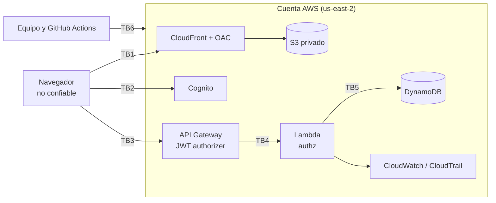

# Modelo de amenazas — Plataforma de Donaciones Seguras

**Versión:** 0.1 (fase 0) | **Fecha:** 2026-11-12
**Fuentes:** [requirements.md](../requirements.md) · [design.md](../design.md) §3 y §6 ·
NIST SP 800-207 · OWASP API Security Top 10 (2023)

Documento vivo. Se revisa al cerrar cada fase y se actualiza la columna **Estado** de la
sección 5. Su versión final alimenta el informe técnico (CA-NF02.3).

## 1. Alcance

Prototipo académico de donaciones **simuladas** (AD-03). No se procesan pagos, no se guardan
datos de tarjetas y solo se usan identidades de prueba (CA-NF10.1). Entran en el análisis:

- La SPA React publicada en S3 privado detrás de CloudFront.
- Amazon Cognito (user pool, managed login y app client público con PKCE).
- API Gateway HTTP API (stage `academic`) y las funciones Lambda de los módulos `projects`,
  `donations`, `authz` y `audit`.
- Las tablas DynamoDB `Projects`, `Donations`, `Idempotency` y `AuditEvents`.
- CloudWatch Logs, CloudTrail, la cuenta AWS (Free plan, `us-east-2`) y el repositorio en
  GitHub con su CI.

Fuera de alcance: pasarela de pagos real, antifraude y postura de los dispositivos (design.md
§6.3).

## 2. Activos

| ID  | Activo                                         | Propiedad que se protege                |
| --- | ---------------------------------------------- | --------------------------------------- |
| A1  | Tokens de Cognito (access, ID y refresh)       | Confidencialidad, vida corta            |
| A2  | Donaciones y acumulado `confirmedAmountCents`  | Integridad (sin dobles conteos)         |
| A3  | Proyectos (borradores y publicados)            | Integridad; borradores no públicos      |
| A4  | Historial de donaciones de cada donante        | Confidencialidad (solo el propietario)  |
| A5  | Logs JSON, `AuditEvents` y CloudTrail          | Integridad y trazabilidad, sin secretos |
| A6  | Cuenta AWS, roles IAM y plantilla SAM          | Integridad, mínimo privilegio           |
| A7  | Repositorio, dependencias npm y pipeline de CI | Integridad de la cadena de suministro   |

## 3. Actores

| Actor                         | Confianza | Puede                                                   |
| ----------------------------- | --------- | ------------------------------------------------------- |
| Visitante anónimo             | Ninguna   | Leer el catálogo público                                |
| DONANTE                       | Baja      | Crear y simular sus donaciones; ver su historial        |
| GESTOR                        | Media     | Crear y publicar proyectos (con MFA)                    |
| AUDITOR                       | Media     | Leer eventos de auditoría (extensión HU-10, con MFA)    |
| Atacante externo              | Ninguna   | Llamar al API directamente, con o sin cuenta de donante |
| Integrante del equipo         | Alta      | Acceder a la cuenta AWS y a GitHub (error o abuso)      |
| Dependencia o asistente de IA | Ninguna   | Introducir código, políticas o comandos                 |

Supuesto de Zero Trust (AD-01): **cualquier solicitud puede venir de un atacante**, aunque
traiga un token válido de un usuario real. El navegador nunca es confiable.

## 4. Límites de confianza

| Límite | Entre                         | Qué se verifica al cruzarlo                                        |
| ------ | ----------------------------- | ------------------------------------------------------------------ |
| TB1    | Navegador → CloudFront        | TLS, cabeceras de seguridad (CSP, HSTS), bucket solo vía OAC       |
| TB2    | Navegador → Cognito           | Authorization Code + PKCE, callback exacto, MFA TOTP               |
| TB3    | Navegador → API Gateway (PEP) | Firma, emisor, expiración, `client_id` y scope del access token    |
| TB4    | API Gateway → Lambda (PE)     | Grupo, propietario del recurso, estado y reglas de negocio         |
| TB5    | Lambda → DynamoDB y logs      | Rol IAM por función, solo las acciones y tablas necesarias         |
| TB6    | Equipo y CI → AWS y GitHub    | Sin root, MFA, sin llaves largas, PR revisado, CI sin credenciales |

## 5. Amenazas STRIDE

**Estado:** ✅ implementado y probado · 🟡 parcial · ⬜ planificado (fase indicada).

### Suplantación (Spoofing)

| ID  | Amenaza                                                 | Límite | Control                                                                          | Evidencia      | Estado |
| --- | ------------------------------------------------------- | ------ | -------------------------------------------------------------------------------- | -------------- | ------ |
| S1  | Token forjado, alterado, caducado o de otro user pool   | TB3    | JWT authorizer: firma (JWKS), `iss`, `exp` y `client_id`                         | T11, CA-NF02.1 | ⬜ F2  |
| S2  | Usar un ID token como si fuera un access token          | TB3    | `AuthorizationScopes` en cada ruta protegida; el ID token no tiene scopes        | T11, D4        | ⬜ F2  |
| S3  | Contraseña robada de un GESTOR o AUDITOR                | TB2    | MFA TOTP obligatorio en roles privilegiados (no SMS)                             | T14, CA-11.2   | ✅ F5  |
| S4  | Interceptar el código de autorización en la redirección | TB2    | PKCE, cliente público sin secreto, URLs de callback exactas, sin flujo implícito | Config. SAM    | ⬜ F2  |
| S5  | Credenciales AWS de un integrante robadas o compartidas | TB6    | Sin root, MFA por integrante, credenciales temporales (`aws login`)              | CA-NF03.3      | ⬜ F0  |

### Manipulación (Tampering)

| ID  | Amenaza                                                          | Límite | Control                                                                                 | Evidencia      | Estado |
| --- | ---------------------------------------------------------------- | ------ | --------------------------------------------------------------------------------------- | -------------- | ------ |
| T1  | El navegador envía `donorSub`, rol, estado o un monto manipulado | TB4    | Backend autoritativo: `sub` del authorizer, Zod, `amountCents` entero y acotado         | T04, CA-NF02.2 | ✅ F4  |
| T2  | Confirmaciones concurrentes cuentan dos veces la misma donación  | TB5    | `TransactWriteItems` con condición `status = PENDIENTE_SIMULACION` y `donorSub = :sub`  | T08, CA-NF04.1 | ✅ F5  |
| T3  | Reintentos o doble clic crean donaciones duplicadas              | TB4    | `Idempotency-Key` + `payloadHash` en la misma transacción que la donación (AD-05)       | T06, T07       | ✅ F4  |
| T4  | Alterar la SPA publicada                                         | TB1    | Bucket privado con OAC; publicación solo desde la plantilla o el procedimiento revisado | CA-NF11.2      | ✅ F5  |
| T5  | Dependencia npm comprometida o vulnerable                        | TB6    | `package-lock.json` con versiones exactas, `npm ci`, `npm audit` en CI, Dependabot      | CI             | ✅ F1  |

### Repudio (Repudiation)

| ID  | Amenaza                                               | Límite | Control                                                                                                              | Evidencia      | Estado                              |
| --- | ----------------------------------------------------- | ------ | -------------------------------------------------------------------------------------------------------------------- | -------------- | ----------------------------------- |
| R1  | Un usuario niega haber donado o publicado un proyecto | TB4    | `AuditEvents` con actor seudonimizado, acción, resultado, `requestId` y fecha, en la misma transacción que el cambio | CA-08.3, HU-10 | 🟡 F3 (proyectos) / F4 (donaciones) |
| R2  | Un cambio de infraestructura sin autor identificable  | TB6    | CloudTrail; cambios solo por PR revisado y plantilla SAM                                                             | CA-NF07.2      | ⬜ F6                               |
| R3  | No poder reconstruir una solicitud fallida            | TB4    | Log JSON por solicitud con `requestId`, acción, resultado, código y duración                                         | CA-NF07.1      | ✅ F1                               |

### Divulgación de información (Information disclosure)

| ID  | Amenaza                                                   | Límite | Control                                                                         | Evidencia       | Estado          |
| --- | --------------------------------------------------------- | ------ | ------------------------------------------------------------------------------- | --------------- | --------------- |
| I1  | BOLA: leer donaciones o historial de otro usuario         | TB4    | Ownership por `sub` contra el registro persistido; 404 sin filtrar existencia   | T09, T12        | ✅ F4           |
| I2  | Ver proyectos en BORRADOR desde el catálogo público       | TB4    | Solo `PUBLICADO`; 404 uniforme para inexistente, inválido o borrador            | T01, CA-02.2    | ✅ F1 (memoria) |
| I3  | Errores que revelan trazas, nombres de tablas o internos  | TB4    | Formato `{ code, message, requestId }`; 500 genérico                            | Tests backend   | ✅ F1           |
| I4  | Tokens o datos personales en logs                         | TB5    | El logger no registra cabeceras, body ni claims; solo metadatos de la solicitud | CA-NF01.2       | 🟡 F1           |
| I5  | XSS que roba tokens                                       | TB1    | Tokens en memoria, CSP restrictiva, React sin `dangerouslySetInnerHTML`         | CA-NF11.1, 11.2 | ✅ F5           |
| I6  | Secretos en el repositorio o en el bundle de la SPA       | TB6    | `.env` ignorado, variables `VITE_*` solo públicas, secret scanning de GitHub    | Repo limpio     | 🟡 F0           |
| I7  | Las estadísticas exponen donantes o importes individuales | TB4    | Solo cifras agregadas del monto confirmado                                      | CA-09.2         | ✅ F1 (memoria) |

### Denegación de servicio (Denial of service)

| ID  | Amenaza                                              | Límite | Control                                                                | Evidencia       | Estado |
| --- | ---------------------------------------------------- | ------ | ---------------------------------------------------------------------- | --------------- | ------ |
| D1  | Inundar el API                                       | TB3    | Throttling del stage (`rate` y `burst`); 429 nativo de API Gateway     | Config. SAM     | ⬜ F2  |
| D2  | Fuerza bruta contra el login                         | TB2    | Bloqueo progresivo de Cognito y política de contraseñas                | Config. Cognito | ⬜ F2  |
| D3  | _Denial of wallet_: agotar los créditos de la cuenta | TB6    | Free plan, alerta de Budgets, recursos on-demand, throttling, limpieza | CA-NF09.1       | ⬜ F0  |

### Elevación de privilegios (Elevation of privilege)

| ID  | Amenaza                                                                    | Límite | Control                                                                                   | Evidencia       | Estado            |
| --- | -------------------------------------------------------------------------- | ------ | ----------------------------------------------------------------------------------------- | --------------- | ----------------- |
| E1  | Un DONANTE llama a rutas de GESTOR (crear o publicar)                      | TB4    | RBAC por `cognito:groups` en `authz`, además del scope                                    | T03             | 🟡 F1 (unit) / F3 |
| E2  | Un usuario se asigna a sí mismo un grupo privilegiado                      | TB2    | Grupos solo por administrador; sin atributos de rol editables por el usuario              | Config. Cognito | ⬜ F2             |
| E3  | Una Lambda comprometida escribe en tablas que no le tocan                  | TB5    | Un rol por función con acciones y ARNs concretos; sin `*` injustificado                   | T10, CA-NF03.1  | ⬜ F2/F6          |
| E4  | Usar la simulación de pago fuera del entorno académico                     | TB4    | La ruta `simulate` solo existe en el stage `academic`                                     | Config. SAM     | ✅ F5             |
| E5  | Un asistente de IA propone políticas con comodines o actúa sobre la cuenta | TB6    | Reglas de design.md §10: PR revisado por otro integrante, sin despliegues sin supervisión | AI_USAGE.md     | 🟡 F0             |

## 6. Relación con NIST SP 800-207

Los componentes (PEP, PE, PA) están en design.md §6.1. Esta tabla une cada principio con las
amenazas que mitiga.

| Principio NIST SP 800-207                         | Amenazas mitigadas |
| ------------------------------------------------- | ------------------ |
| 1. Todo dato y servicio es un recurso             | I2, I7, E3         |
| 2. Comunicación segura sin importar la red        | S4, I5             |
| 3. Acceso por sesión y por recurso                | S1, I1, E1         |
| 4. Política dinámica                              | T1, T2, E4         |
| 5. Monitorear la postura de los activos (parcial) | T5, S5             |
| 6. Autenticación y autorización estrictas         | S1, S2, S3, E1, E2 |
| 7. Recolectar información para mejorar            | R1, R2, R3, D3     |

## 7. Relación con OWASP API Security Top 10 (2023)

| Riesgo OWASP                                         | Amenazas   | Nota                                              |
| ---------------------------------------------------- | ---------- | ------------------------------------------------- |
| API1 Broken Object Level Authorization               | I1         | Ownership por `sub` en cada acceso                |
| API2 Broken Authentication                           | S1, S2, S3 | JWT authorizer, scopes, MFA                       |
| API3 Broken Object Property Level Authorization      | T1, I7     | El cliente no fija `donorSub` ni estados          |
| API4 Unrestricted Resource Consumption               | D1, D3     | Throttling y límites de presupuesto               |
| API5 Broken Function Level Authorization             | E1, E4     | RBAC por grupo y ruta `simulate` acotada al stage |
| API6 Unrestricted Access to Sensitive Business Flows | T2, T3     | Idempotencia y transacciones condicionadas        |
| API7 Server Side Request Forgery                     | —          | El API no hace solicitudes a URLs del cliente     |
| API8 Security Misconfiguration                       | I3, I5, E3 | Errores genéricos, CORS por lista, cabeceras      |
| API9 Improper Inventory Management                   | —          | `docs/api.yaml` probado contra las rutas reales   |
| API10 Unsafe Consumption of APIs                     | —          | Sin APIs de terceros en el MVP                    |

## 8. Riesgos residuales aceptados

- **Revocación diferida:** un access token revocado sigue siendo válido hasta que expira
  (≤ 15 min), porque el JWT authorizer valida localmente (AD-07, T13).
- **Sin postura de dispositivo ni riesgo adaptativo:** Verified Access y Cognito Plus quedan
  fuera del Free plan (design.md §6.3).
- **Sin WAF:** HTTP API no se integra con AWS WAF; la protección se limita al throttling.
- **Cuenta compartida:** el aislamiento entre integrantes depende de IAM y de la disciplina del
  equipo.
- **MFA por pool, no por grupo:** con MFA opcional, el TOTP de GESTOR y AUDITOR se garantiza por
  el procedimiento de alta (decisión D5).
- **Alertas moderadas de herramientas de desarrollo:** se aceptan mientras no lleguen al
  código de producción (política de `npm audit` de la fase 1).

## 9. Mantenimiento

- Al cerrar cada fase, actualizar la columna **Estado** y enlazar el PR con la evidencia.
- Toda ruta, tabla o rol nuevo debe aparecer en una amenaza de la sección 5 o justificar por qué
  no la necesita.
